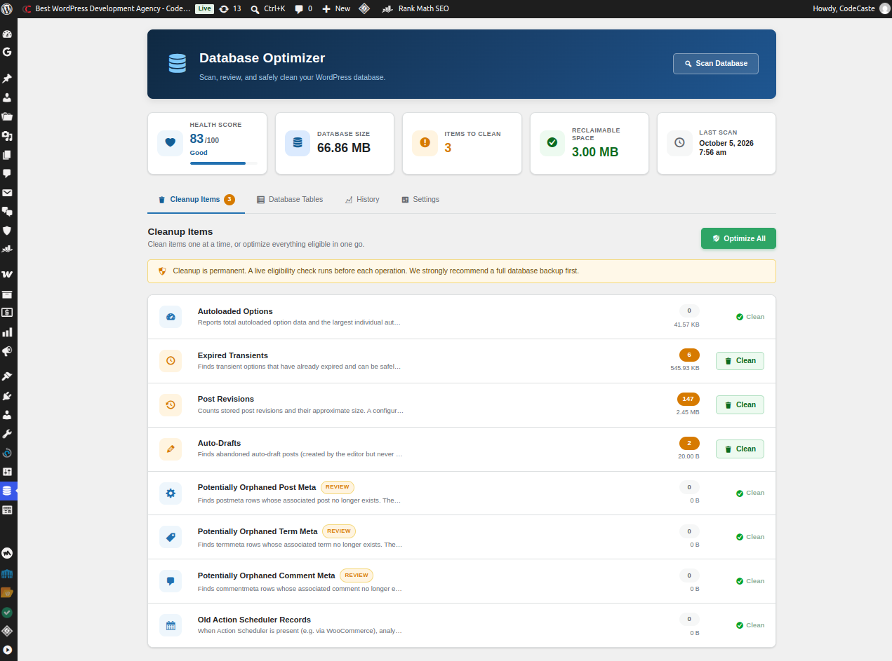

# CodeCaste Database Cleaner & Optimizer

Find out what's making your WordPress database large, identify potentially unnecessary data, and safely clean it after review.

## Features

- Database health scanning across common bloat sources
- Review optimization opportunities before cleanup
- Controlled batch optimization for supported records
- Covers revisions, transients, orphaned meta, autoloaded options, and more
- Built for safer WordPress database cleanup workflows

## Requirements

- WordPress 6.2+
- PHP 7.4+

## Installation

1. Download or clone this repository into `wp-content/plugins/codecaste-database-cleaner-optimizer`
2. Activate **CodeCaste Database Cleaner & Optimizer** in WordPress
3. Open the plugin dashboard to scan and review results

## WordPress.org

- Slug: `codecaste-database-cleaner-optimizer`
- Plugin page: https://wordpress.org/plugins/codecaste-database-cleaner-optimizer/

## Repository

- GitHub: https://github.com/code-caste/codecaste-database-cleaner-optimizer
- Maintainer: [Bhushan-Gohel](https://github.com/Bhushan-Gohel)
- Website: [CodeCaste](https://www.codecaste.com)

## License

GPLv2 or later — see [LICENSE](LICENSE).
